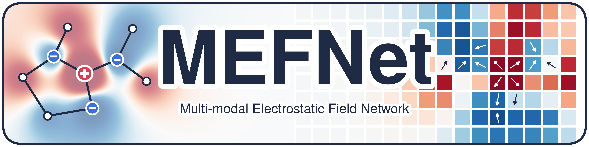
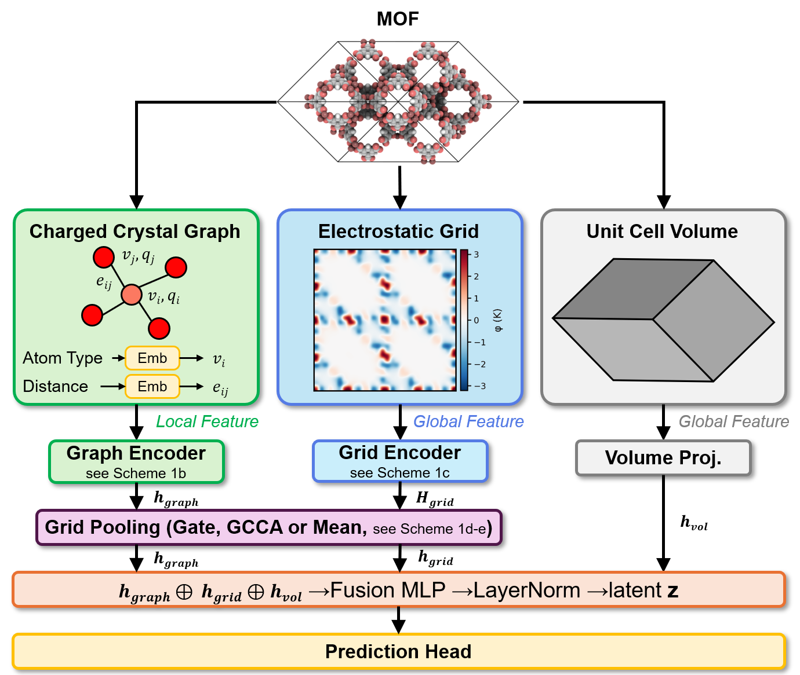

  

# Integrating charge information into multi-modal learning for predicting metal-organic framework hydrophobicity

### Contact
Prof. Chung: 	drygchung@gmail.com
Sunghyun Yoon: 	tjdgusdbs8810@gmail.com

### Cite as
Will be updated

## Introduction

MEFNet (Multi-modal Electrostatic Field Network) classifies MOFs as hydrophobic or hydrophilic from three inputs computed for
each structure: a charged crystal graph (atoms, bonds and PACMAN partial charges), a four-channel Ewald electrostatic grid
(potential and field) and the unit cell volume.

  

## Code, data and trained weights

Everything needed to reproduce the work is in the MEFNet repository: https://github.com/yoonseonghyun/MEFNet

- Graph and grid generation from CIFs (`generate_graphs.py`, `generate_grids.py`)
- Duplicate-aware group split and random split (`split_group.py`, `split_random.py`)
- Training, Optuna hyperparameter tuning and prediction (`train.py`, `tune.py`, `predict.py`)
- CoRE MOF 2024 hydrophobicity labels and the splits used in the paper (`data/coremof2024/`)
- Trained weights of the three grid-pooling variants (`weights/mean`, `weights/gate`, `weights/gcca`)
- 20 example structures and a quick-start workflow that runs on a CPU (`examples/`)

CIFs are available from the CoRE MOF 2024 database (https://zenodo.org/records/15055758).
